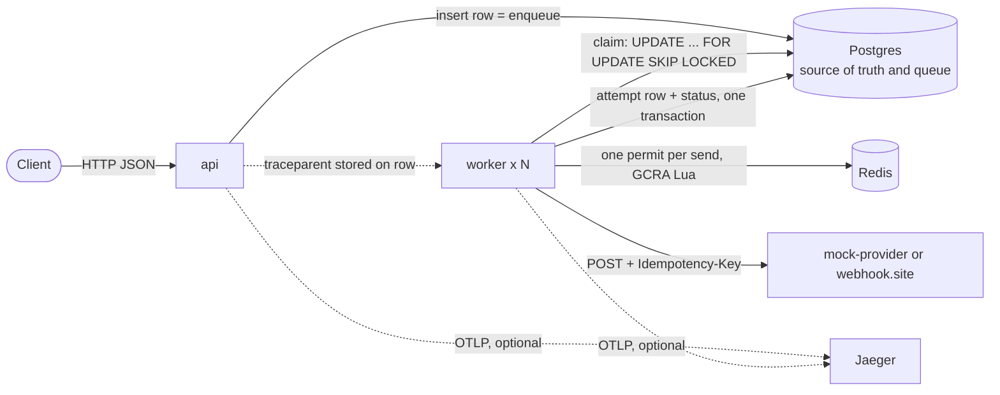

# Insider notification system

An event driven notification service in Go. An HTTP API accepts SMS, email and push notifications, Postgres stores them and doubles as the queue, workers deliver them to an external provider (webhook.site or the bundled mock), and a Redis GCRA limiter keeps every channel at or below 100 messages per second across all worker replicas.

## Quick start

Requirements: Docker with Compose v2. Nothing else is needed to run the system.

```bash
docker compose up -d --build     # or: make up
curl -s localhost:8080/readyz    # {"checks":{"postgres":"ok","redis":"ok"},"status":"ok"}
```

The stack starts Postgres, Redis, a one shot `migrate` job, `api` on `127.0.0.1:8080`, `worker` and `mock-provider` (inspection port `127.0.0.1:9090`). Stop it with `make down` (also deletes the volume).

To deliver to webhook.site instead of the mock, copy `.env.example` to `.env` and set `PROVIDER_URL=https://webhook.site/<your-uuid>`. `.env` is gitignored; the URL is never logged.

Running the tests needs Go 1.27 and Docker (integration tests start real Postgres and Redis with testcontainers):

```bash
make test    # unit, integration and contract tests with -race
make e2e     # full compose stack, API phase then engine phase
make lint    # golangci-lint
make load    # k6 burst against the compose stack (k6 runs in Docker)
```

## Quick demo

```bash
# Create one notification. The Idempotency-Key makes a retry of this request safe.
curl -s -X POST localhost:8080/v1/notifications \
  -H 'Content-Type: application/json' -H 'Idempotency-Key: demo-1' \
  -d '{"recipient":"+905551234567","channel":"sms","content":"Flash sale starts now","priority":"high"}'

# Same key, same body: 200 with the same notification. Same key, different body: 409.

# Status, including every delivery attempt
curl -s localhost:8080/v1/notifications/<id>

# Batch of up to 1000, all or nothing
curl -s -X POST localhost:8080/v1/notifications/batch -H 'Content-Type: application/json' \
  -d '{"notifications":[{"recipient":"a@example.com","channel":"email","content":"Hi"},
                         {"recipient":"device-token-1","channel":"push","content":"Hi"}]}'
curl -s localhost:8080/v1/batches/<batch_id>          # counts by status
curl -s -X POST localhost:8080/v1/batches/<batch_id>/cancel

# List with filters and cursor pagination
curl -s 'localhost:8080/v1/notifications?status=sent&channel=sms&limit=20'

# Scheduled send (future, at most 30 days ahead)
curl -s -X POST localhost:8080/v1/notifications -H 'Content-Type: application/json' \
  -d '{"recipient":"+905551234567","channel":"sms","content":"Reminder","scheduled_at":"2030-01-01T09:00:00Z"}'

# Templates with {{var}} substitution, rendered and validated at create time
curl -s -X POST localhost:8080/v1/templates -H 'Content-Type: application/json' \
  -d '{"name":"welcome","channel":"sms","body":"Hi {{name}}, your code is {{code}}"}'
curl -s -X POST localhost:8080/v1/notifications -H 'Content-Type: application/json' \
  -d '{"recipient":"+905551234567","channel":"sms","template_id":"<template_id>","template_vars":{"name":"Ada","code":"4711"}}'

# Requeue a failed notification (dead letter)
curl -s -X POST localhost:8080/v1/notifications/<id>/retry

# Metrics
curl -s localhost:8080/metrics | grep notifications_
```

The full contract is `api/openapi.yaml` (OpenAPI 3.0.3). A contract test keeps it in sync with the router, and about 70 real responses are validated against it.

## Architecture



Flow of one notification:

1. The API validates the request, renders a template if one is used, and inserts one row with `status = pending`. That insert is the enqueue, so there is no dual write and no outbox.
2. Each worker runs one claim loop per channel, so a slow or failing channel never blocks the others. A loop claims only as many rows as it has free sender slots, highest priority first, with `FOR UPDATE SKIP LOCKED`, and gives each claimed row a fresh `lease_token` and a 30 second lease.
3. Before each send the worker takes one permit from the channel's Redis limiter, then starts the attempt with a single conditional update that renews the lease and proves ownership.
4. It calls the provider with `Idempotency-Key: <notification id>`, then, in one transaction, records the attempt and moves the row to `sent`, back to `pending` with a backoff, or to `failed`.
5. A reaper returns rows whose lease expired (crashed worker) to `pending`.

```
pending --claim--> processing --2xx--> sent
   ^                  |-- retryable, attempts left --> pending (next_attempt_at = backoff)
   |                  |-- permanent, exhausted or expired --> failed
   |                  '-- lease expired --reaper--> pending
   |-- cancel --> cancelled (only from pending)
failed --POST /retry--> pending
```

Every transition is one `UPDATE ... WHERE status = <expected>` and every write out of `processing` also requires the row's `lease_token`, so races (cancel against claim, two workers, a stale worker after the reaper) are settled by Postgres. A worker whose update matches zero rows has lost the row and drops it.

## API

| Method and path | Purpose |
|---|---|
| `POST /v1/notifications` | Create one (`content`, or `template_id` with `template_vars`). 201 new, 200 idempotent replay, 409 key reused with another payload, 422 validation |
| `POST /v1/notifications/batch` | Up to 1000 items, all or nothing, one optional `Idempotency-Key` for the batch |
| `GET /v1/notifications/{id}` | Status, details and attempt history |
| `GET /v1/notifications` | Filters `status`, `channel`, `batch_id`, `created_from`, `created_to`; cursor pagination (`limit` up to 100) |
| `POST /v1/notifications/{id}/cancel` | Cancel if pending, else 409 |
| `POST /v1/notifications/{id}/retry` | Requeue a failed notification, else 409 |
| `GET /v1/batches/{id}`, `POST /v1/batches/{id}/cancel` | Batch counts by status, cancel all pending items |
| `POST /v1/templates`, `GET /v1/templates`, `GET /v1/templates/{id}` | Templates |
| `GET /healthz`, `GET /readyz`, `GET /metrics` | Liveness, Postgres and Redis readiness, Prometheus |

Errors are RFC 7807 `application/problem+json` with a per field `errors` array. Every response echoes `X-Request-ID`, which becomes the notification's correlation id and follows it into the worker logs.

Validation: sms recipient E.164, content up to 160 characters; email recipient a plain address up to 254 bytes, content up to 10000 characters; push recipient a device token up to 255 characters without whitespace, content up to 256 characters. Bodies are size capped, unknown JSON fields are rejected.

## Delivery guarantees

What a marketer can rely on:

- **Accepted means stored.** A 201 means the notification is committed in Postgres. A crash of any process after that does not lose it.
- **At least once, not exactly once.** If a worker dies after the provider accepted a message but before the row is marked `sent`, the reaper requeues it and it is sent again. Every provider call carries `Idempotency-Key: <notification id>` so a provider that honors it (the mock does) drops the duplicate. Exactly once is not claimed.
- **Never faster than 100 per second per channel**, across all worker replicas, because the limit lives in Redis and the clock is Redis's.
- **High before normal before low**, strictly.
- **Retries are bounded.** Up to 8 real send attempts with exponential backoff and full jitter (base 2s, cap 10 min; about 4 minutes worst case across the 7 waits). 429 responses do not use an attempt but honor `Retry-After`. Nothing is retried after 24 hours (`MAX_DELIVERY_AGE`): a flash sale SMS a day late is worse than none.
- **Failures are visible and recoverable.** `failed` is the dead letter state: list it with `status=failed`, read every attempt with its HTTP status and error, and requeue with `/retry`.
- **Cancel is safe.** It only succeeds while the row is still pending; a row already being sent returns 409.
- **If Redis is down, sending pauses** (the limiter fails closed) and `/readyz` reports `degraded`, instead of risking provider limits during a campaign.

## Why each component exists

| Component | Why |
|---|---|
| Postgres (pgx/v5) | Source of truth and the queue. Creating and enqueuing is one insert. One claim query covers priority, retry delay and scheduled delivery. The case's ceiling is 300 sends per second in total, well inside one Postgres. |
| Redis (go-redis/v9) | The rate limit must hold across worker replicas, so it cannot be an in-memory counter. One Lua script per channel, Redis clock. |
| GCRA instead of a token bucket | A bucket of 100 allows about 200 sends in a window that straddles a refill. GCRA spaces grants at least 10 ms apart, so no 1 second window holds more than 100. |
| Separate `api` and `worker` | Scale delivery without scaling the API: `docker compose up -d --scale worker=3`. |
| `mock-provider` | webhook.site free URLs cannot absorb e2e and load tests. The mock has configurable latency, failure rate and status scripts, records arrival times and dedups by `Idempotency-Key`. |
| golang-migrate | Versioned, append only migrations, embedded in the binary and run by a one shot `migrate` service before anything else starts. |
| stdlib `net/http` router, `log/slog` | Go 1.22+ patterns are enough; fewer dependencies to explain. JSON logs with correlation id, notification id, channel and attempt. |
| Prometheus client | Queue depth by channel, priority and state; created, sent and failed counters; provider latency and end to end latency histograms; breaker state; limiter wait. |
| OpenTelemetry | One trace follows a notification from the HTTP request through the queue to the provider call (see Observability). Off unless configured. |
| testcontainers-go | Integration tests run against real Postgres and Redis, because the interesting bugs (claim races, idempotency races, limiter spacing) only show up there. |
| kin-openapi | The contract test keeps the spec and the router in sync and validates real responses against the spec. |

## Observability

- **Metrics:** `GET /metrics` on the API; the worker exposes its own on port 8081 inside the compose network. Queue depth is computed by the API only (one collector, not one per replica) every 5 seconds.
- **Logs:** JSON via slog. Recipients, content, template variables, the provider URL and provider response bodies are never logged.
- **Tracing:** `make up-tracing` starts the stack with a Jaeger container and sets `OTEL_EXPORTER_OTLP_ENDPOINT`. Open `http://localhost:16686`. The API stores the W3C `traceparent` on the row; the worker's `deliver` span is its child, and the `provider.send` span injects `traceparent` into the outgoing request. Without the variable, tracing exports nothing.

## Tests and numbers

257 test functions (plus 24 named subtests), all run with `-race`:

| Suite | Tests | What it covers | Time on my machine |
|---|---|---|---|
| `make test`, internal packages | 232 | Domain validation, retry policy, breaker, templates, provider classification; store, limiter and API tests against real Postgres and Redis in testcontainers (claim races, lease fencing, idempotency races, limiter spacing) | about 25s with a warm build cache |
| `make test`, `tests/integration` and `tests/contract` | 9 | Every route and response validated against `api/openapi.yaml`; compose config checks (tracing profile, host env isolation) | included above |
| `make e2e` | 15 | The full compose stack: API phase with the worker stopped, then engine phase (delivery, 5xx retries, permanent and exhausted failures, 429 handling, scheduled sends, priority order, cancel before claim, rate per channel) | 86s in total (API phase 1.6s, engine phase 45s) |

Plus one mock provider test in `cmd/`. CI runs lint, test and e2e on every push.

**Load test** (`make load`, k6 against the compose stack, one worker replica with the default 10 senders per channel, mock provider with its default latency):

| | Result |
|---|---|
| Burst | 10,000 notifications in 10 batch requests of 1,000, split evenly across sms, email and push, accepted in 0.2s (batch request p95 84ms) |
| Outcome | 10,000 `sent`, 0 failed, queue drained 43s after the burst |
| Delivery rate | 93.6 per second per channel, against the 100 per second limit |
| Rate limit, measured at the provider | Busiest 1 second sliding window: 102 arrivals per channel. The limiter spaces grants 10ms apart with no burst; the 2 extra are network jitter between grant and arrival. The check allows 105. |
| End to end latency (created to sent) | p50 18.6s, p95 34.4s. Almost all of it is queue wait: 3,333 messages at 100 per second need 33s per channel, so p95 is close to the floor the rate limit sets. |

## Deliberately not built

- **WebSocket status updates.** Doing it safely needs connection caps, an origin check, bounded per client buffers, write deadlines and a single Redis subscription fanned out by the API. With the time left I chose tracing across the queue, which says more about the system, and kept status available through `GET /v1/notifications/{id}` and `GET /v1/batches/{id}`. The design (worker publishes status changes on a Redis channel, API fans out filtered by id or batch) is ready to build.
- **Authentication, API keys, multi tenancy.** Out of scope for the case. Compose publishes the API only on `127.0.0.1`; a real deployment needs auth and ingress limits first.
- **Kafka, RabbitMQ, Kubernetes.** Postgres already gives a transactional queue with priority and delay; a broker would need an outbox and delayed delivery machinery for no gain at 300 sends per second.
- **Real SMS, email and push providers.** webhook.site and the mock stand in for them.
- **A UI.**

## Assumptions I decided

- 2xx from the provider always means sent, even if the body does not parse; retrying a 2xx would double send.
- Only real send attempts count toward the 8 attempt budget. 429 and breaker pauses do not.
- `max_attempts` is 8 for every notification and not configurable per request.
- Batches are all or nothing: one invalid item rejects the whole request with per item errors by index, so a client can fix and resend with the same key. Only the batch has an idempotency key.
- Priority is strict. Low priority can starve under sustained high load (see next steps).
- An attempt whose outcome is unknown (worker died mid send) counts as used, because the provider may have received it.
- Idempotency keys are kept forever.
- Template rendering happens at create time; a missing variable is a 422.
- The circuit breaker opens per channel after 10 consecutive provider failures and stays open 30 seconds, then lets one probe through.

## Known limitations and next steps

- **Breaker state is per worker replica.** With N replicas the provider sees up to N probes. Next step: shared breaker state in Redis.
- **Strict priority can starve `low`.** Next step: aging (raise effective priority with wait time).
- **Idempotency keys never expire.** Next step: a TTL and a cleanup job.
- **One Postgres primary.** Fine for 300 sends per second. The queue sits behind an interface; at much larger scale, partition by channel and move to Kafka or Redis Streams with an outbox (see `docs/adr/`).
- **After a manual retry, a row that had already reached `MAX_DELIVERY_AGE` gets one attempt** before it expires again, because age is measured from `COALESCE(scheduled_at, created_at)`.
- **A claim interrupted by shutdown** can leave its rows in `processing` until the reaper returns them (at most the 30 second lease).
- **`queue_depth` is absent from `/metrics` until the first successful refresh** after the API starts.
- **The e2e rate check measures wall clock rates,** so a very slow host can make it flaky. CI on Linux is the reference.
- The OpenAPI spec does not document the router's own 405 and unmatched route 404 responses.

## Repository map

```
cmd/            api, worker, mockprovider, migrate binaries
internal/       domain, store, api, worker, ratelimit, provider, template, observability, config
migrations/     versioned SQL
api/            openapi.yaml
tests/          contract, integration, e2e (build tag e2e), load (k6)
docs/adr/       architecture decision records
docs/agent-log.md   how the AI agents were used, and where they were wrong
```

## How I used AI

I built this with AI agents and kept myself as the owner of every decision.

- **Design first.** A written design spec (requirements, data model, state machine, claim query, retry policy) was reviewed by OpenAI Codex in read only mode before any code. Its findings (stale worker fencing with `lease_token`, claim sizing, unknown attempt outcomes and more) changed the design.
- **One task, one agent, one commit.** Claude Opus planned and briefed each task; Claude Sonnet subagents wrote the test first, then the code, then one conventional commit. Codex reviewed every task diff for spec compliance and code quality. Every finding was verified against the code before it was applied, and fixes are separate `fix(...)` commits, so the review loop is visible in the history.
- **Where the agents were wrong** is recorded in [`docs/agent-log.md`](docs/agent-log.md): for example a test that never reached the code path it claimed to cover, a validation gap for empty template variables, a lint action one major version behind. Each entry links the commit that fixed it.
- **Where I was wrong.** For a while I put a slow e2e rate test down to Docker Desktop latency. The load test agent then found the real cause: my shell exported a `DATABASE_URL` for another project, and the compose file let it override the bundled Postgres. Code review could not catch it because the code was right. The compose file now pins its own URLs behind a test, and the engine e2e phase went from 279s to 45s.
- **Gates.** Every checkpoint ended with `make test`, `make lint` and `make e2e` on the full stack before the next one started.
